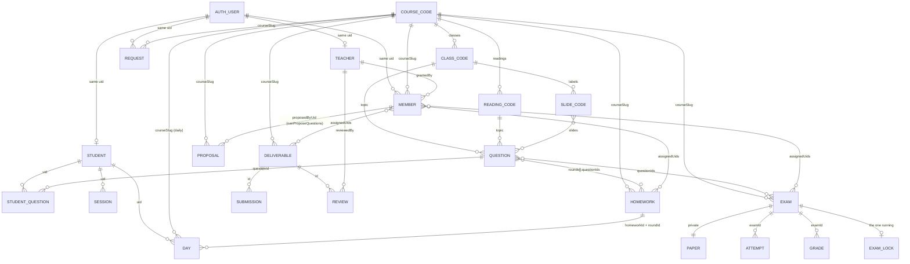

# Data model: every table and how they relate

The map of everything the platform stores, read as if it were a relational database. The detail of each area (what the pages do with the data, the rules, the setup) stays in [practice.md](practice.md), [exam.md](exam.md), [deliverables.md](deliverables.md) and [courses.md](courses.md); this file only answers *what tables exist, what their keys are and which field points at which*. The rules themselves are in `firebase/firestore.rules`.

## Three stores, not one

| Store | What it holds | Where it is defined |
|---|---|---|
| **Firestore** | Everything below: questions, progress, homeworks, exams, deliverables, memberships, roles | Firebase console; collection names in `src/data/*/types.ts` |
| **Firebase Auth** | The accounts: `uid`, `displayName`, `email`, sign-in method. There is no users table in Firestore; the `uid` is the key everything else hangs from | Firebase console → Authentication |
| **Code** | The courses, their classes, the slides of each class and their readings: `LEARN_COURSES` in `src/data/learn.ts`. A course, class or reading slug stored in Firestore is a foreign key into this list | Git |

## Reading Firestore as tables

- A **collection** is a table, a **document** is a row and the **document id** is its primary key. A **subcollection** is a table whose primary key includes the parent's id: `exams/{examId}/attempts/{uid}` is the table *attempts* with key (examId, uid).
- **Arrays and maps inside a document** (`rounds[]`, `questionIds[]`, `answers {}`) are what SQL would put in a child or join table. They are embedded because Firestore reads and charges whole documents: one read per document, whatever its size.
- **There are no joins.** The browser reads the documents it needs and joins them in memory, and every foreign key is a plain string that nothing enforces. A pointer to a document that no longer exists is shown as missing (for instance "Question no longer in the bank"), which is why questions are retired rather than deleted.
- **Names are copied, not joined.** `displayName` and `email` are written into the member, request, student, attempt and submission documents at the time of the write, so a list can be shown without reading one Auth account per row.
- **Cost is per document read**, not per byte. Loading the practice reads the whole `questions` collection, one read per question, retired ones included; the filter by course, class and `retired` happens in the browser.
- **A `set` replaces the whole document.** The question editor saves with `set`, so a field the code does not know about disappears from that question on its next save. Every new field of a document must enter its type, its parser and its export, or it will not survive an edit.

## Map

```
Firebase Auth                 users: uid, displayName, email
Code (src/data/learn.ts)      LEARN_COURSES: course.slug → classes[].slug → slide ids
                                             course.slug → readings[].slug

teachers/{uid}                                         role: exists = is a teacher
settings/examLock                                      one document: the exam running right now

courses/{courseSlug}/members/{uid}                     enrollment, and what it allows
courses/{courseSlug}/requests/{uid}                    access request, deleted when answered

questions/{questionId}                                 practice bank (also drawn into exams)
examQuestions/{questionId}                             exam-only bank, same fields, ids x-…
questionProposals/{id}                                 a question a student proposes for a course's bank

students/{uid}                                         one per account that practiced
  questions/{questionId}                               the account's stats on one question
  sessions/{sessionId}                                 one visit with at least one answer
  days/{courseSlug}_{YYYY-MM-DD}                       daily homework of one course on one day
  days/hw-{homeworkId}-{roundId}_{YYYY-MM-DD}          one round of a specific homework on one day

homeworks/{homeworkId}                                 specific homework: rounds of question ids and days

exams/{examId}                                         multiple option exam
  private/paper                                        the drawn questions with the answer key (server only)
  attempts/{uid}                                       what one student saw and answered (server writes)
  grades/{uid}                                         score and key for one student (server writes)

deliverables/{id}                                      homework or exam handed in as text or link
  submissions/{uid}                                    what one student handed in
  reviews/{uid}                                        score and comments for one student
```

## Tables

Field lists are the current ones; `?` marks optional fields. "Written by" says who may create or change the row under the rules: *student* means the account's own browser, *teacher* a browser signed in as a teacher, *server* the exam API routes with the admin SDK, which skip the rules.

### teachers/{uid}

| Key | Fields | Written by | Read by | Detail |
|---|---|---|---|---|
| `uid` (Auth) | any (the document only has to exist) | nobody from the site: by hand in the console | its owner | [practice.md](practice.md), setup step 6 |

### settings/examLock

| Key | Fields | Written by | Read by | Detail |
|---|---|---|---|---|
| fixed id `examLock` | `examId`, `closesAt` | server, when an exam opens or closes | any signed-in account (the rules read it to pause practice) | [exam.md](exam.md) |

### courses/{courseSlug}/members/{uid}

| Key | Fields | Written by | Read by | Detail |
|---|---|---|---|---|
| (`courseSlug` from code, `uid` from Auth) | `displayName`, `email`, `joinedAt`, `grantedBy`, `canProposeQuestions?` | teacher | its owner, teachers | [courses.md](courses.md) |

The course document `courses/{courseSlug}` never exists: Firestore keeps subcollections without a parent, and the course itself is the entry in `LEARN_COURSES`. `canProposeQuestions` is a permission of the membership, false when missing: the student may propose questions for the course's bank. The rules read it (`canProposeIn`), so it is the one field of this table another table's writes depend on.

### courses/{courseSlug}/requests/{uid}

| Key | Fields | Written by | Read by | Detail |
|---|---|---|---|---|
| (`courseSlug`, `uid`) | `displayName`, `email`, `requestedAt` | created by the student, deleted by a teacher | its owner, teachers | [courses.md](courses.md) |

### questions/{questionId} and examQuestions/{questionId}

| Key | Fields | Written by | Read by | Detail |
|---|---|---|---|---|
| `questionId` (`wu-wo-014`, `q-003`; exam-only `x-wu-wo-002`): assigned on save, never reused | `topic?`, `slides[]?`, `prompt {es, en}`, `correct[] {id, es, en}`, `incorrect[] {id, es, en, level}`, `explanation? {es, en}`, `retired`, `updatedAt` | teacher | `questions`: any signed-in account while no exam runs; `examQuestions`: teachers and the server | [practice.md](practice.md), [exam.md](exam.md) |

Two tables with the same columns on purpose: students read the first and must never read the second. A question never moves between them. The ids of its answers (`correct[].id`, `incorrect[].id`) are what exam attempts and grades point at.

### questionProposals/{id}

| Key | Fields | Written by | Read by | Detail |
|---|---|---|---|---|
| generated id | `courseSlug`, `topic?`, `prompt {es, en}`, `correct[] {es, en}`, `incorrect[] {es, en, level?}`, `explanation? {es, en}`, `status 'pending' \| 'accepted' \| 'rejected'`, `proposedByUid`, `proposedByName`, `proposedByEmail`, `createdAt`; once decided: `questionId?`, `decidedByUid`, `decidedByName`, `decidedAt`, `reason?` | created by a student whose membership has `canProposeQuestions`; updated and deleted by teachers | its author, teachers | [practice.md](practice.md), Question proposals |

A proposal is not a question: it has no bank id, `en` may be an empty string and the wrong answers may have no level. It stays in this table after it is decided, as the record of who proposed what.

### students/{uid}

| Key | Fields | Written by | Read by | Detail |
|---|---|---|---|---|
| `uid` (Auth) | `displayName`, `email`, `createdAt`, `lastPlayedAt`, `sessionsPlayed`, `totalAnswered`, `totalCorrect` | student | its owner, teachers | [practice.md](practice.md) |

Created by the first answer the account gives, so it lists who practiced, not who signed in: the enrolled are in `members`.

### students/{uid}/questions/{questionId}

| Key | Fields | Written by | Read by |
|---|---|---|---|
| (`uid`, `questionId`) | `attempts`, `correct`, `lastCorrect`, `lastAnsweredAt` | student | its owner, teachers |

### students/{uid}/sessions/{sessionId}

| Key | Fields | Written by | Read by |
|---|---|---|---|
| (`uid`, generated id) | `startedAt`, `lastAnswerAt`, `answered`, `correct` | student | its owner, teachers |

### students/{uid}/days/{dayKey}

| Key | Fields | Written by | Read by |
|---|---|---|---|
| (`uid`, `{courseSlug}_{YYYY-MM-DD}`) | `courseSlug`, `day`, `answered`, `correct`, `bestRun`, `updatedAt` | student | its owner, teachers |
| (`uid`, `hw-{homeworkId}-{roundId}_{YYYY-MM-DD}`) | `homeworkId`, `roundId`, `day`, `answered`, `correct`, `bestRun`, `updatedAt` | student | its owner, teachers |

One table, two kinds of row told apart by the key and by which of `courseSlug` or `homeworkId` is present: the daily homework of a course, and one round of a specific homework. The teacher's board and the student's history are computed from these rows ([practice.md](practice.md)).

### homeworks/{homeworkId}

| Key | Fields | Written by | Read by | Detail |
|---|---|---|---|---|
| generated id | `title`, `courseSlug`, `rounds[] {id, questionIds[], goal}`, `firstDay`, `lastDay`, `createdAt`, `assignedUids[]`, `forEveryone` | teacher | teachers; the members of the course it is for | [practice.md](practice.md), [courses.md](courses.md) |

### exams/{examId}

| Key | Fields | Written by | Read by | Detail |
|---|---|---|---|---|
| generated id | `title`, `courseSlug`, `questionIds[]`, `maxQuestions`, `durationMinutes`, `assignedUids[]`, `forEveryone`, `status 'draft' \| 'opened'`, `createdAt`, `openedAt`, `closesAt`, `paperSize` | teacher while a draft; server from `open` on | teachers; once opened, the members it is for | [exam.md](exam.md) |

### exams/{examId}/private/paper

| Key | Fields | Written by | Read by |
|---|---|---|---|
| (`examId`, fixed id `paper`) | `questions[] {id, prompt, options[] {id, text}, correctOptionId}` | server | server only: no browser, not even a teacher's |

### exams/{examId}/attempts/{uid}

| Key | Fields | Written by | Read by |
|---|---|---|---|
| (`examId`, `uid`) | `displayName`, `email`, `status 'started' \| 'submitted'`, `questions[] {id, prompt, options[] {id, text}}`, `answers {questionId: optionId}`, `startedAt`, `submittedAt`, `late`, `lateBySeconds` | server | its owner, teachers |

The texts are frozen in the row, so a replay stays exact after the bank is edited.

### exams/{examId}/grades/{uid}

| Key | Fields | Written by | Read by |
|---|---|---|---|
| (`examId`, `uid`) | `score`, `total`, `correctOptionIds {questionId: optionId}` | server | teachers; its owner once `closesAt` has passed |

### deliverables/{id}

| Key | Fields | Written by | Read by | Detail |
|---|---|---|---|---|
| generated id | `title`, `courseSlug`, `role 'homework' \| 'exam'`, `kind 'text' \| 'repo' \| 'docLink'`, `guideUrl`, `instructions`, `questions[] {id, text, maxChars \| null, points}`, `maxScore`, `assignedUids[]`, `forEveryone`, `durationMinutes`, `deadline`, `status 'draft' \| 'opened'`, `createdAt`, `openedAt`, `closesAt` | teacher | teachers; once opened, the members it is for | [deliverables.md](deliverables.md) |

### deliverables/{id}/submissions/{uid}

| Key | Fields | Written by | Read by |
|---|---|---|---|
| (`id`, `uid`) | `displayName`, `email`, `answers {questionId: text}`, `url`, `typing {…} \| null`, `firstSavedAt`, `savedAt` | student while the deliverable is opened and is for them; deleted only by a teacher | its owner, teachers |

### deliverables/{id}/reviews/{uid}

| Key | Fields | Written by | Read by |
|---|---|---|---|
| (`id`, `uid`) | `score \| null`, `maxScore`, `comment`, `scores {questionId: number \| null}`, `comments {questionId: string}`, `reviewedAt`, `reviewedBy` | teacher (or the import script) | its owner, teachers |

## Relations

Every arrow is a stored string (or list of strings) that names a key somewhere else. Nothing enforces them: the code that reads the pointing row looks the target up and copes when it is missing.

| From | Field | To | Notes |
|---|---|---|---|
| `teachers/{uid}` | key | Auth user | The role is the row's existence |
| `courses/{c}/members/{uid}` | key `c` | `LEARN_COURSES[].slug` (code) | |
| `courses/{c}/members/{uid}` | key `uid` | Auth user | |
| `courses/{c}/members/{uid}` | `grantedBy` | `teachers/{uid}`, or the literal `enroll-all` | |
| `courses/{c}/requests/{uid}` | keys | course (code), Auth user | Deleted when accepted or rejected |
| `questions/{id}` | `topic` | `LEARN_COURSES[].classes[].slug` or `LEARN_COURSES[].readings[].slug` (code): a topic, `courseTopics` | **The only link between a question and a course**: the course is found through the class or the reading. One topic per question. A question without `topic`, or with a slug no class and no reading has, belongs to no course and is never drawn into practice (`questionsInScope`); a question without `topic` gets an id that starts with `q-` |
| `questions/{id}` | `slides[]` | slide ids of that class's deck (code) | Keys of the deck dictionary's `labels`. Empty when the topic is a reading: readings have no slides |
| `questions/{id}` | id prefix | course and topic initials | A label only: a question moved to another class or reading keeps its id |
| `questionProposals/{id}` | `courseSlug` | course (code) | The course whose bank it is for; the create rule looks the author's membership up with it |
| `questionProposals/{id}` | `topic` | a class or a reading of that course (code) | Optional |
| `questionProposals/{id}` | `proposedByUid` | Auth user; `courses/{courseSlug}/members/{uid}` | Must be the caller on create; the student's list query filters by it |
| `students/{uid}` | key | Auth user | |
| `students/{uid}/questions/{q}` | key `q` | `questions/{q}` or `examQuestions/{q}` | A retired question still resolves; a deleted one shows as "no longer in the bank" |
| `students/{uid}/days/…` | `courseSlug` | course (code) | Daily homework rows |
| `students/{uid}/days/…` | `homeworkId`, `roundId` | `homeworks/{id}`, `homeworks.rounds[].id` | Specific homework rows; a removed round leaves its rows unseen |
| `homeworks/{id}` | `courseSlug` | course (code) | |
| `homeworks/{id}` | `rounds[].questionIds[]` | `questions/{id}` | The practice bank only, never the exam-only one |
| `homeworks/{id}`, `exams/{id}`, `deliverables/{id}` | `assignedUids[]` | `courses/{courseSlug}/members/{uid}` | Empty list plus `forEveryone: true` means every member |
| `exams/{id}` | `courseSlug` | course (code) | |
| `exams/{id}` | `questionIds[]` | `questions/{id}` or `examQuestions/{id}` | Either bank |
| `exams/{id}/private/paper` | `questions[].id`, `options[].id`, `correctOptionId` | question ids and answer ids of the banks | Copied when the exam opens; the bank may change afterwards |
| `exams/{id}/attempts/{uid}` | `answers {q: option}` | `paper.questions[].options[].id` = `correct[].id` / `incorrect[].id` in the bank | Why answer ids must survive edits and imports |
| `exams/{id}/grades/{uid}` | `correctOptionIds {q: option}` | the same answer ids | |
| `settings/examLock` | `examId` | `exams/{id}` | |
| `deliverables/{id}` | `courseSlug` | course (code) | |
| `deliverables/{id}/submissions/{uid}` | `answers {q: text}` | `deliverables.questions[].id` | Ids local to the deliverable |
| `deliverables/{id}/reviews/{uid}` | `scores {q}`, `comments {q}` | `deliverables.questions[].id` | |
| `deliverables/{id}/reviews/{uid}` | `reviewedBy` | `teachers/{uid}`, or the script's `--by` | |

### Diagram

Entities and their links, for a renderer that understands Mermaid (GitHub, GitLab, VS Code with a Mermaid extension). The tables above are the source; this is the picture.



`COURSE_CODE`, `CLASS_CODE`, `READING_CODE` and `SLIDE_CODE` live in `src/data/learn.ts`, not in Firestore; `AUTH_USER` lives in Firebase Auth.
